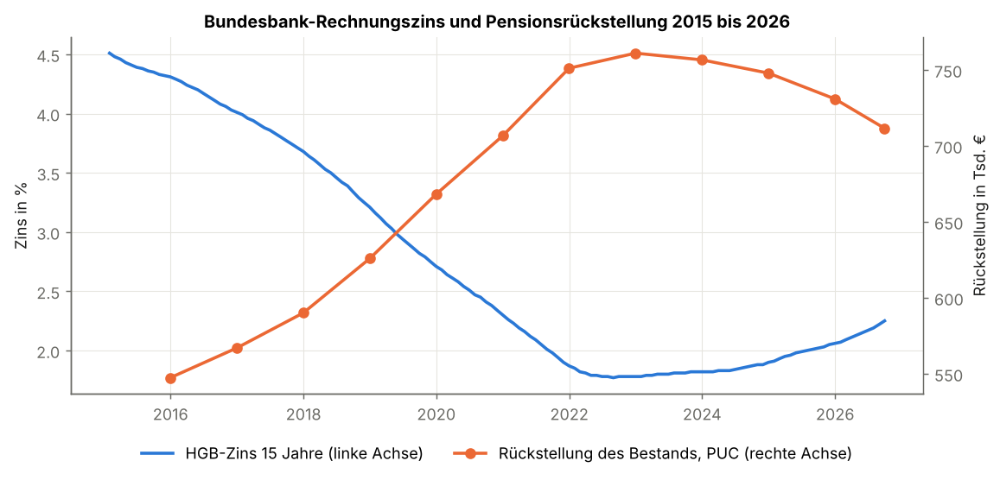
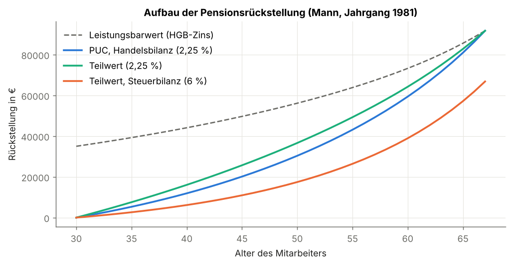
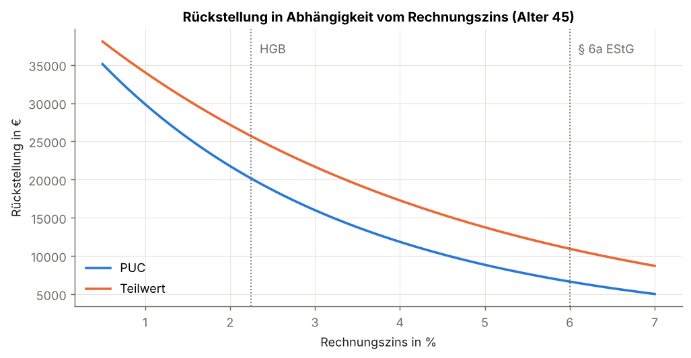
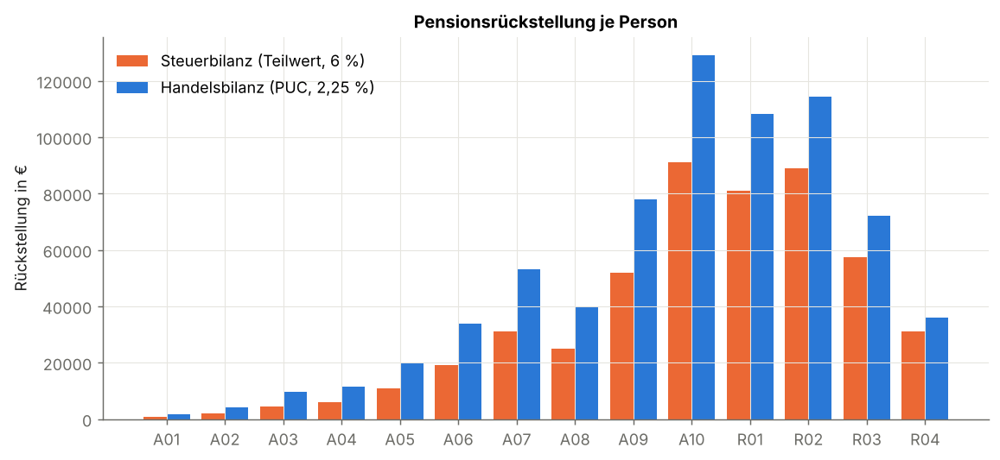
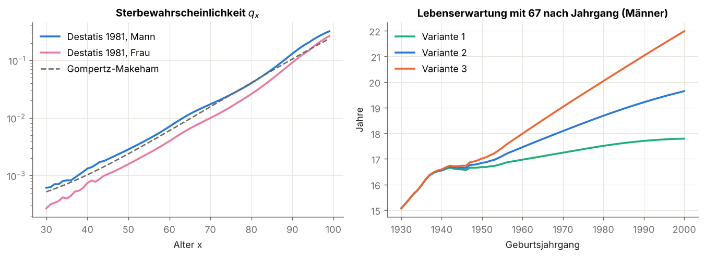

# Bewertung von Pensionsrückstellungen: Teilwertverfahren vs. Projected Unit Credit


Lernprojekt zur Pensionsversicherungsmathematik (betriebliche Altersversorgung)
Autor: **Noreddine Razzouk**

---

## Überblick

`bavpension` ist eine kleine, getestete Python-Bibliothek, die Pensionsrückstellungen einer Direktzusage mit **echten Rechnungsgrundlagen** bewertet:

1. **Sterblichkeit:** Kohortensterbetafeln (Generationentafeln) des Statistischen Bundesamts, 2026, für jeden Geburtsjahrgang, beide Geschlechter und drei Annahmen zum Anstieg der Lebenserwartung,
2. **Rechnungszins:** Abzinsungszinssätze der Deutschen Bundesbank nach § 253 Abs. 2 HGB, 2015 bis 2026,
3. **Bewertung** nach dem **Teilwertverfahren** (Steuerbilanz, § 6a EStG) und der **Projected-Unit-Credit-Methode** (HGB, IFRS),
4. **Analysen:** Zinssensitivität und Duration, Langlebigkeitsrisiko, Bewertung eines Personenbestands und Entwicklung der Rückstellung von 2015 bis 2026.

Grundlage ist der DAV-Leitfaden *Versicherungsmathematik*, Kapitel 5 (Grundwissen Pensionsversicherungsmathematik).



## Mathematischer Hintergrund

### Rechnungsgrundlagen

Für eine Person des Geburtsjahrgangs $G$ ist $q_x^{(G)}$ die Wahrscheinlichkeit, im Alter $x$, also im Kalenderjahr $G + x$, zu sterben. Eine **Kohortentafel** folgt damit der Diagonale der Periodentafeln und berücksichtigt die künftig steigende Lebenserwartung, so wie die in der Praxis verwendeten Heubeck-Richttafeln 2018 **G** (Generationentafeln).

$${}_tp_x = \prod_{k=0}^{t-1} \big(1 - q^{(G)}_{x+k}\big), \qquad v = \frac{1}{1+i}.$$

### Barwerte

| Barwert | Formel | Bedeutung |
|---|---|---|
| Leibrente | $\ddot a_x = \sum_{k \ge 0} v^k\,{}_kp_x$ | lebenslange Rente, vorschüssig |
| temporäre Leibrente | $\ddot a_{x:\overline{n}\vert} = \sum_{k=0}^{n-1} v^k\,{}_kp_x$ | höchstens $n$ Zahlungen |
| aufgeschobene Leibrente | ${}_{n\vert}\ddot a_x = v^n\,{}_np_x\,\ddot a_{x+n}$ | Rente beginnt in $n$ Jahren |
| Leistungsbarwert | $B^L_x = R \cdot {}_{z-x\vert}\ddot a_x$ | Altersrente $R$ ab Alter $z$ |

### Bewertungsverfahren

Mit Diensteintrittsalter $e$, Alter am Stichtag $x$ und Pensionierungsalter $z$:

- **Teilwertverfahren** (Prinzip der Prämiengleichverteilung):
$$P = \frac{B^L_e}{\ddot a_{e:\overline{z-e}\vert}}, \qquad V^{TW}_x = B^L_x - P \cdot \ddot a_{x:\overline{z-x}\vert}$$
- **Projected Unit Credit** (verursachungsgerechte Zuordnung zur Dienstzeit):
$$V^{PUC}_x = \frac{x-e}{z-e} \cdot B^L_x$$

### Zinssensitivität

$$D = \frac{\sum_t t\,v^t\,CF_t}{\sum_t v^t\,CF_t}, \qquad \frac{\Delta V}{V} \approx -\frac{D}{1+i}\,\Delta i.$$

## Ergebnisse

Stichtag **30.09.2026**, HGB-Zins (15 Jahre) **2,25 %**, Steuerzins 6 %, Destatis-Variante 2 (mittel).
Alle Zahlen werden von `python scripts/run_experiments.py` erzeugt (vollständig in [docs/results.md](docs/results.md)).

### 1. Einzelbewertung

Mann, Jahrgang 1981, Eintritt mit 30, heute 45, zugesagte Altersrente 6.000 € pro Jahr ab 67.

| Bilanz | Verfahren | Zins | Rückstellung |
|---|---|---|---|
| Steuerbilanz | Teilwert | 6,00 % | 10.943 € |
| Handelsbilanz | PUC | 2,25 % | 20.140 € |
| (Vergleich) | Teilwert | 2,25 % | 25.685 € |

**Erkenntnisse:**
- Die HGB-Rückstellung ist **1,8-mal so hoch** wie der steuerliche Wert.
- Beim gleichen Zins wäre der Teilwert sogar *höher* als PUC, weil er den Aufwand gleichmäßig verteilt und dadurch früher aufbaut. Der Unterschied zwischen Handels- und Steuerbilanz entsteht also vor allem durch den **Rechnungszins**, nicht durch das Verfahren.



### 2. Zinssensitivität

Die Verpflichtung des 45-Jährigen hat eine Duration von etwa 32 Jahren: 0,5 Prozentpunkte weniger Zins erhöhen die Rückstellung um etwa 17 %.



### 3. Bewertung eines Bestands

Fiktiver Bestand mit 10 Aktiven und 4 Rentnern ([data/bestand.csv](data/bestand.csv)). Jede Person wird mit der Kohortentafel **ihres Jahrgangs und Geschlechts** bewertet.

| | Steuerbilanz (Teilwert, 6 %) | Handelsbilanz (PUC, 2,25 %) |
|---|---|---|
| Summe | 500.634 € | 711.545 € |

- Die Differenz von rund 211.000 € belastet das handelsrechtliche Ergebnis, ist steuerlich aber nicht abzugsfähig.
- Effektive Duration des Bestands: **14,0 Jahre**, nahe an der pauschalen Restlaufzeit von 15 Jahren nach § 253 Abs. 2 HGB.



### 4. Langlebigkeitsrisiko

Destatis rechnet drei Annahmen zum künftigen Anstieg der Lebenserwartung.

| Variante | Lebenserwartung mit 67 (Mann 1981) | Rückstellung Bestand (PUC) | Änderung |
|---|---|---|---|
| 1 (niedrig) | 17,5 Jahre | 691.155 € | −2,9 % |
| 2 (mittel) | 18,7 Jahre | 711.545 € | 0 |
| 3 (hoch) | 20,1 Jahre | 733.814 € | +3,1 % |

Etwa **1,2 Jahre mehr Lebenserwartung** erhöhen die Rückstellung um rund **3 %**. Zum Vergleich: 0,5 Prozentpunkte weniger Zins erhöhen sie um 7,4 %. Für diesen Bestand ist das Zinsrisiko also deutlich größer als das Langlebigkeitsrisiko.



### 5. Entwicklung 2015 bis 2026

Derselbe Bestand, bewertet mit dem HGB-Zins verschiedener Bilanzstichtage (Grafik oben):

| Stichtag | HGB-Zins | Rückstellung |
|---|---|---|
| 31.12.2015 | 4,31 % | 547.386 € |
| 31.12.2022 | 1,78 % | 761.009 € (Höchststand) |
| 30.09.2026 | 2,25 % | 711.545 € |

Durch die Niedrigzinsphase stieg die Rückstellung bis 2022 um **39 %**, ohne dass sich an den Zusagen etwas geändert hat. Seit 2023 steigt der Durchschnittszins wieder, und die Rückstellungen sinken. Das entlastet die Jahresabschlüsse der Unternehmen.

## Validierung

Die Tests (`tests/`, 25 Tests) prüfen die Implementierung gegen bekannte Identitäten und veröffentlichte Werte:

| Bereich | Was wird geprüft |
|---|---|
| Sterbetafeln | $0 \le q_x \le 1$, ${}_{s+t}p_x = {}_sp_x \cdot {}_tp_{x+s}$, Frauen leben länger, Variante 1 < 2 < 3, jüngere Jahrgänge leben länger |
| Barwerte | Zerlegung $\ddot a_x = \ddot a_{x:\overline{n}\vert} + {}_{n\vert}\ddot a_x$, Zeitrente bei $q = 0$, Zinsabhängigkeit |
| Bewertung | Rückstellung $= 0$ bei Eintritt, $= B^L$ bei Rentenbeginn, monoton in der Dienstzeit, Steuerwert < HGB-Wert, Duration-Näherung |
| Daten | Bundesbank-Werte 31.12.2024 (1,90 %) und 31.12.2025 (2,06 %), höhere Lebenserwartung → höhere Rückstellung |

Die Tests laufen automatisch mit GitHub Actions auf Python 3.10 und 3.12.

## Datenquellen

| Daten | Quelle | Datei |
|---|---|---|
| Sterbewahrscheinlichkeiten | Statistisches Bundesamt (Destatis), *Kohortensterbetafeln für Deutschland 1926–2026*, Statistischer Bericht, 16.09.2026, EVAS 12621 | `data/destatis_kohortensterbetafeln.csv` |
| Rechnungszins | Deutsche Bundesbank, *Abzinsungszinssätze gemäß § 253 Abs. 2 HGB, 10-Jahresdurchschnitt*, 01/2015 bis 09/2026 | `data/bundesbank_hgb_zins_10j.csv` |
| Personenbestand | fiktiv | `data/bestand.csv` |

© Statistisches Bundesamt (Destatis), 2026. Vervielfältigung und Verbreitung, auch auszugsweise, mit Quellenangabe gestattet.
Die CSV-Dateien werden mit `scripts/prepare_data.py` aus den Original-Excel-Dateien erzeugt.

## Projektstruktur

```
bav-pension-valuation/
├── src/bavpension/
│   ├── sterbetafel.py   # Sterbetafel-Grundklasse, Gompertz-Makeham-Modell
│   ├── daten.py         # Destatis-Kohortentafeln, Bundesbank-Zins
│   ├── barwerte.py      # Leibrenten, Leistungsbarwert, Duration
│   ├── bewertung.py     # Teilwertverfahren, Projected Unit Credit
│   └── bestand.py       # Einlesen und Bewerten eines Personenbestands
├── data/                # Destatis, Bundesbank, fiktiver Bestand (CSV)
├── tests/               # 25 Validierungstests (pytest)
├── scripts/
│   ├── prepare_data.py      # Original-Excel -> CSV
│   └── run_experiments.py   # erzeugt alle Grafiken und Tabellen
├── docs/                # Grafiken und Ergebnisse
└── .github/workflows/   # Continuous Integration
```

## Installation und Nutzung

```bash
git clone https://github.com/Razzouknoreddine/bav-pension-valuation.git
cd bav-pension-valuation
python -m venv .venv && source .venv/bin/activate
pip install -e ".[dev]"

pytest -v                           # Tests ausführen
python scripts/run_experiments.py   # alle Ergebnisse reproduzieren
```

Beispiel:

```python
from bavpension import KohortenSterbetafel, hgb_zins, puc, teilwert

tafel = KohortenSterbetafel(jahrgang=1981, geschlecht="m", variante=2)
print(teilwert(tafel, e=30, x=45, z=67, rente=6000, zins=0.06))       # Steuerbilanz
print(puc(tafel, e=30, x=45, z=67, rente=6000, zins=hgb_zins()))      # Handelsbilanz
```

## Vereinfachungen und Ausblick

- **Heubeck-Richttafeln 2018 G** statt Destatis (in der Praxis vorgeschrieben bzw. üblich; lizenzpflichtig). In der Steuerbilanz wären sie Pflicht, hier wird für beide Bilanzen dieselbe Destatis-Tafel verwendet.
- weitere Ausscheideursachen: **Invalidität** und **Fluktuation**, d. h. das Zustandsmodell aktiv / invalide / Rentner / tot (Markov-Kette, Leitfaden Abschnitt 5.2)
- **Hinterbliebenenrente** (Witwen- und Witwerrente)
- **Gehalts- und Rententrend** (Anpassung nach § 16 BetrAVG)
- laufzeitabhängige **Zinskurve** der Bundesbank statt pauschal 15 Jahre
- Bewertung nach **IAS 19** und Ausweis versicherungsmathematischer Gewinne und Verluste

## Literatur

- Deutsche Aktuarvereinigung, *Leitfaden für das Grundwissen Versicherungsmathematik*, 2018
- K. Wolfsdorf, *Versicherungsmathematik, Teil 1: Personenversicherung*, Teubner
- K. Heubeck, *Richttafeln 2018 G*, Heubeck AG
- § 253 HGB, § 6a EStG, IAS 19 *Employee Benefits*

## Lizenz

Code: MIT. Daten: siehe Datenquellen.
